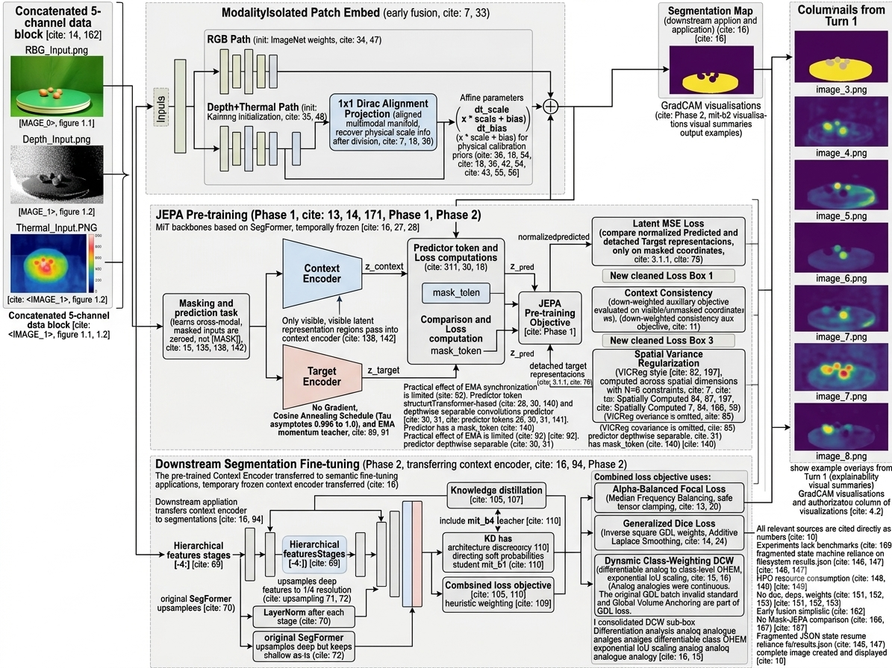
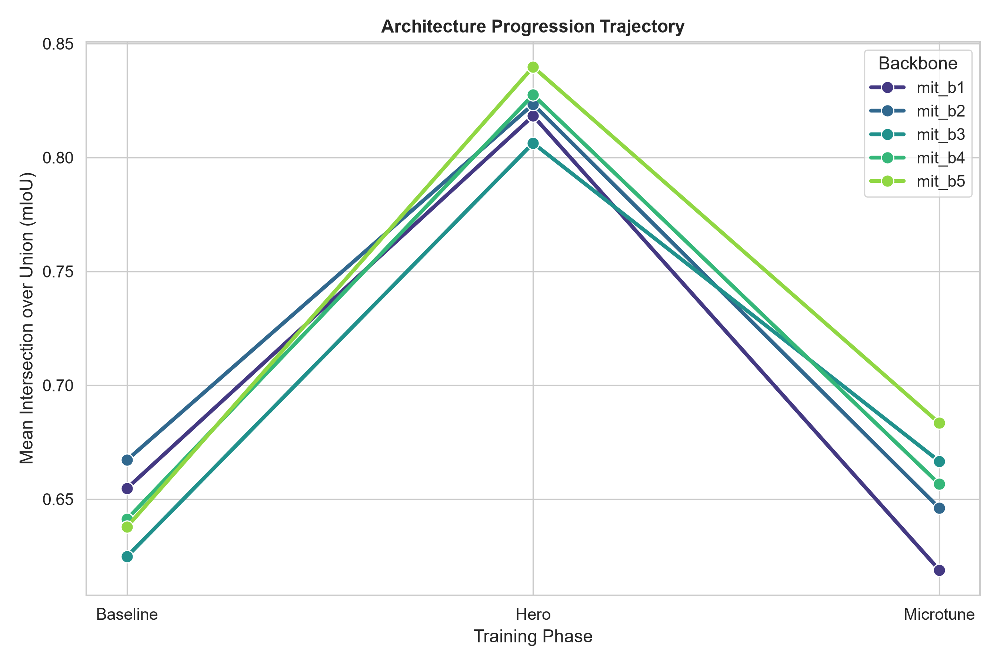
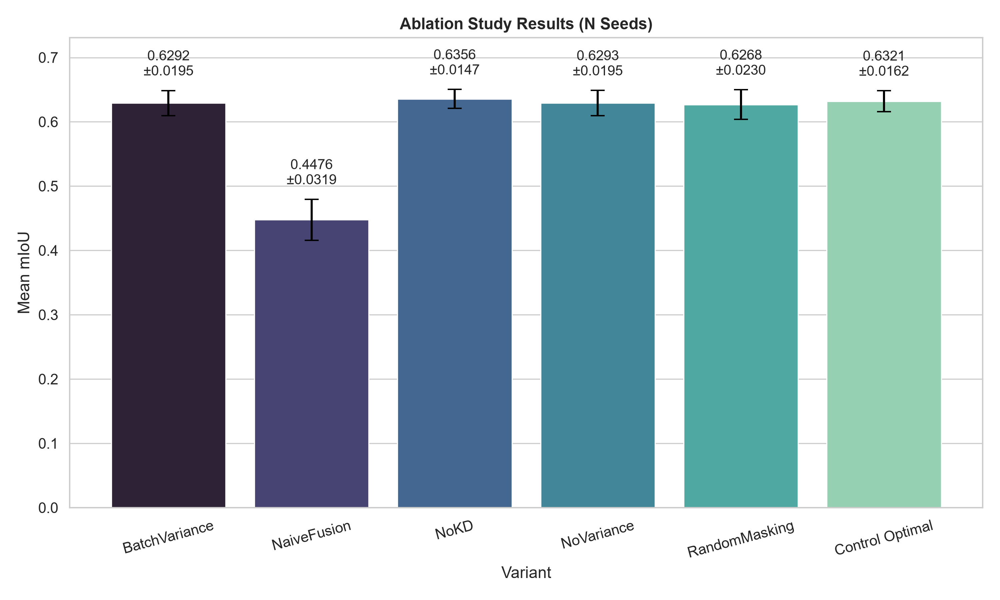
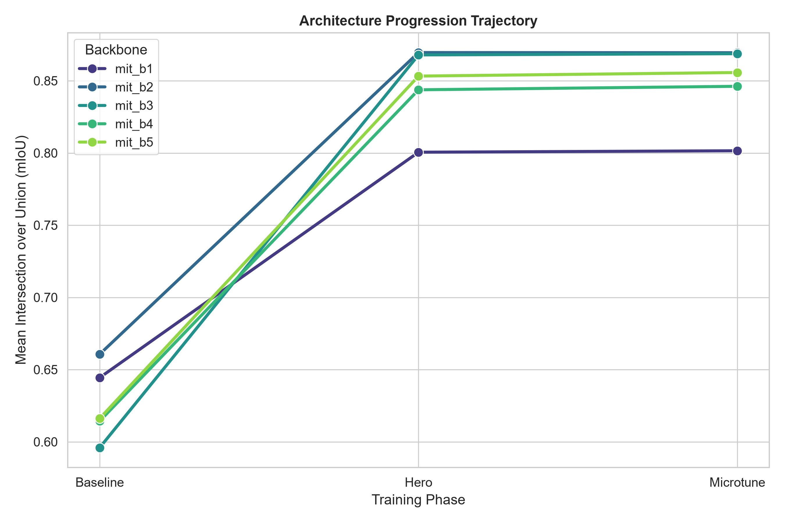
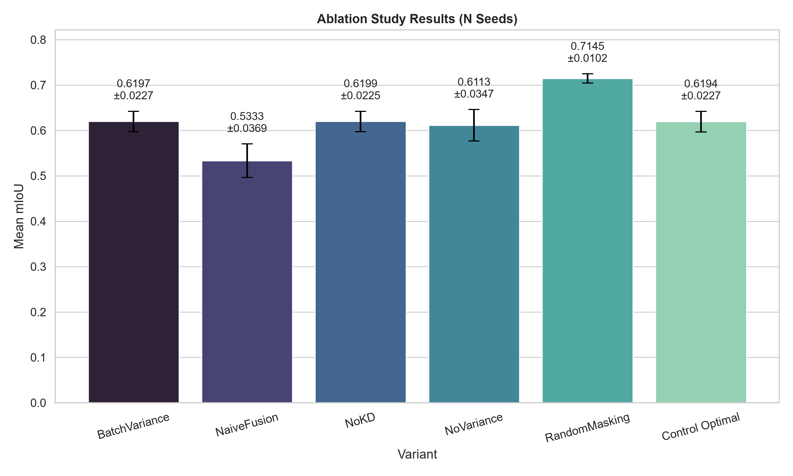
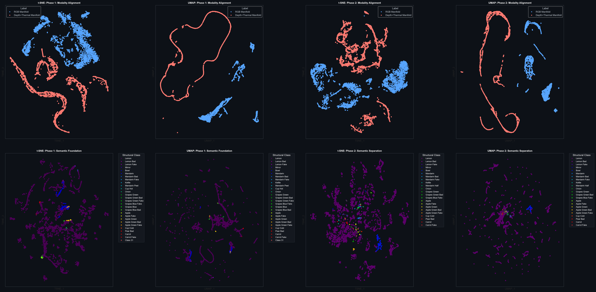
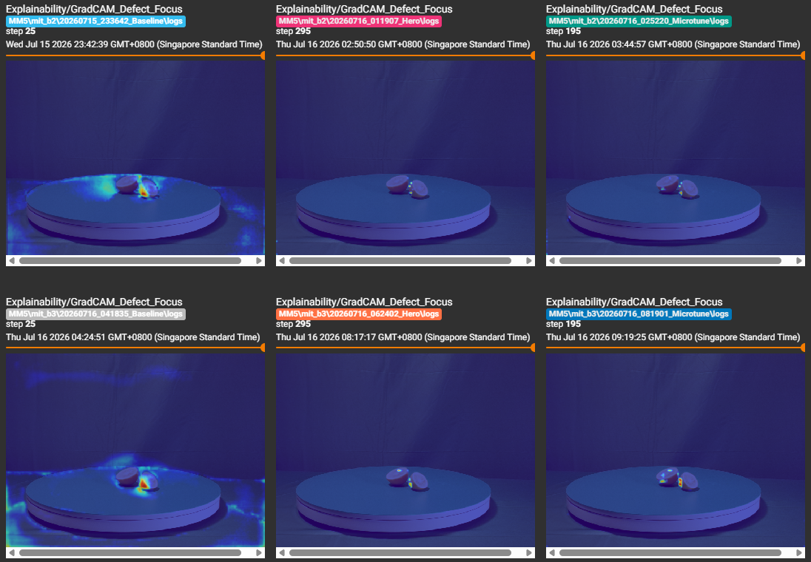

# TriModal Perception Architectures for Structural Defect Detection: The MM-JEPA Paradigm

## Abstract

Structural defect and organic anomaly detection in industrial environments requires the reliable integration of RGB, Depth, and Thermal (RGB-D-T) sensor modalities [17]. This repository documents the architecture, mathematical formulation, and MLOps engineering of a spatial perception engine designed for bounded edge hardware [16]. To avoid the quadratic memory cost of non-hierarchical cross-attention networks [4] and the high-frequency radiometric noise reconstruction of pixel-space autoencoders [1], we introduce the Tri-Modal Latent Predictive Network (`TMLPN_v3`) built upon a Multimodal Joint-Embedding Predictive Architecture (MM-JEPA) [2]. By decoupling self-supervised representation learning from downstream semantic segmentation [9] and enforcing strict mathematical and engineering boundaries—including leakage-gated stratified sequence-aware splits, data-plane RGB-only normalization, valid-pixel depth and identity-centered thermal calibration, Dirac-initialized alignment projections [7], Concurrent Spatial-Channel Squeeze & Excitation (scSE) gating [29], target-preserving Modality Dropout [31], encoder-level Variance-Invariance-Covariance Regularization (VICReg) [11], interior-eroded Sobel boundary supervision, and checkpoint-exact Feature-Level Knowledge Distillation [23]—the framework establishes a reproducible foundation model for real-time edge inference [17].

---

## Repository Layout & Quickstart

### Core Modules

| File | Role |
| :--- | :--- |
| `config.yaml` | Clean master configuration defining dataset resolution, Phase 1 MM-JEPA hyperparameters (`warmup_epochs`, `min_lr`, `mask_ratio`), and Phase 2 downstream / HPO / ONNX settings (`onnx_opset: 16`). Never mutated in place by the orchestrator. |
| `freeze_splits.py` | Adapts canonical `train_dataset.csv` and `eval_dataset.csv` manifests into locked 3-way splits (`train.csv`, `val.csv`, `test.csv`) with hard train/eval leakage enforcement, group-aware and rare-class-stratified 50/50 partitioning, and `split_audit.json` generation. |
| `dataset_jepa.py` | Enforces data-plane RGB-only normalization, native $[0, 1]$ Depth/Thermal physical scaling with 8-bit/16-bit sanity warnings, split-interpolation planar augmentations, stride-32 aligned configurable-ratio random patch masking, target-preserving Modality Dropout, and manifest-hash-keyed atomic statistics caching. |
| `models.py` | Implements `ModalityIsolatedPatchEmbed` (with `forward_split`), `ConcurrentSpatialChannelSE`, asymmetric `PositionalEncoding2D`, non-leaking `SpatialJEPAPredictor`, `MultimodalJEPA`, `SegFormerAllMLPDecoder`, `LoRALinear` (serializing `lora_alpha` as a buffer), `TMLPN_Downstream_v1`/`v2`/`v3`, and `instantiate_model_from_checkpoint` (supporting `encoder_only` strict loading). |
| `pretrain_jepa.py` | Phase 1 self-supervised MM-JEPA pre-training with encoder-level VICReg (`z_context`), centered physical anchoring priors, linear warmup + cosine LR decay, gradient clipping, SMP-safe `weights_only=True` checkpoint resume, and completion-gated encoder export. |
| `train_downstream.py` | Phase 2 5-stage state machine (`PHASE_SEQUENCE`: `baseline` $\rightarrow$ `hpo` $\rightarrow$ `hero` $\rightarrow$ `microtune` $\rightarrow$ `export`) with `load_phase1_encoder_weights` (SMP override bypass + LoRA `.original_layer` key remapping), strict `weights_only=True` checkpointing, exact teacher KD reconstruction, full-precision GDL/Focal/Sobel loss, tensor-hook `SegmentationGradCAM`, blind test HFlip TTA, and `opset_version=16` ONNX export. |
| `ml_pipeline.py` | Multi-seed ($N=5$) MLOps orchestrator writing immutable per-trial YAMLs (`.pipeline_configs/`), `KNOWN_ABLATION_KEYS` validation, child-process determinism environment injection, teacher-first scheduling, validation-only optimal backbone selection, strict Phase 1 artifact reuse, degenerate-ablation skipping (`skipped_ablations.json`), and durable error logging (`pipeline_errors.log`). |
| `analyse_results.py` | Unified statistical and latent evaluation suite reporting unbiased sample standard deviation (`ddof=1`), seed-aligned paired $t$-tests with 95% confidence intervals and Benjamini-Hochberg FDR [32] (excluding skipped trials), significance-annotated bar plots, strict `weights_only=True` checkpoint loading, honest `N/A` panels for Naive Fusion, and full-test uniform UMAP/t-SNE projections. *(Replaces the deprecated `visualize_latents.py`.)* |
| `validate_pipeline.py` | 9-check zero-dataset pre-flight validation suite verifying stem dropout stability, 2D PE asymmetry, predictor non-leakage, encoder VICReg gradients, Phase 1 $\rightarrow$ Phase 2 LoRA key remapping & rank/alpha reload, downstream V1/V2/V3 & LLRD parity, cross-ablation teacher KD, Grad-CAM hooks, provider-matched ONNX runtime parity, and orchestrator/analysis invariants. |
| `config_utils.py` | YAML configuration loader and CLI override dispatcher. |

### End-to-End Execution Workflow

```bash
# 1. Install dev runtime for ONNX numerical parity checks (first-time setup)
uv add --dev onnxruntime

# 2. Freeze and audit stratified 3-way canonical splits
#    (Add --group_regex "^(.+)_\d+$" if filenames encode sequential capture prefixes)
uv run freeze_splits.py --dataset MM5 --stratify_by_mask

# 3. Run the 9-check pre-flight validation suite before committing GPU compute
uv run validate_pipeline.py --device cuda --opset 16

# 4. Launch the multi-seed (N=5) training and ablation orchestration matrix
uv run ml_pipeline.py --dataset MM5 --model TMLPN_Downstream_v3

# 5. Aggregate metrics, paired-t BH-FDR statistics, and full-test UMAP/t-SNE manifolds
uv run analyse_results.py --model TMLPN_Downstream_v3 --dataset MM5
```

> **Repository Hygiene Note:** Ensure `.env` (SMTP alert credentials) and `.pipeline_configs/` (ephemeral per-trial YAMLs) are listed in `.gitignore` prior to committing.

---

## 1. Introduction

Integrating multimodal sensors improves the detection of surface and subsurface structural defects and organic anomalies [17]. While architecture development and statistical benchmarking in this repository are conducted on the 5-channel MM5 benchmark dataset [17, 18], the validated model is engineered for deployment on our developing fused sensor array comprising a Nuwa HP60C RGB-D camera and a $640 \times 512$ Long-Wave Infrared (LWIR) Vanadium Oxide thermal sensor on bounded edge compute modules [16, 17].

Early iterations of multimodal self-supervised learning relied on generative pixel-space decoders [1]. Reconstructing raw pixel intensities forces the network to allocate capacity to high-frequency sensor noise and ambient thermal drift [1]. To prevent this, TMLPN transitions to latent-space prediction via a two-phase self-supervised and supervised pipeline [2, 9].

### 1.1 Architectural Deviations: TMLPN vs. Multi-Trunk Multimodal Architectures

Server-scale multimodal representation frameworks (such as multi-encoder contrastive models like ImageBind [3] or late-fusion multimodal JEPA variants) typically assign independent Vision Transformer trunks per modality with deep cross-attention joint embeddings. TMLPN deviates from late-fusion ViT trunks for three hardware-grounded reasons:

1. **Memory-Bandwidth Constraints:** Maintaining multiple independent ViT trunks in VRAM exceeds the shared-memory and bandwidth limits of embedded edge devices [16].
2. **Computational Complexity:** Standard non-hierarchical self-attention scales quadratically at $O(N^2)$ with respect to spatial resolution, preventing real-time inference on high-resolution industrial frames [4].
3. **Hardware-Aware Early Fusion:** TMLPN uses a single hierarchical Mix Transformer (MiT) trunk preceded by a structurally isolated modality stem [9]. The hierarchical sequence reduction in MiT maintains efficient scaling [9], while Dirac-initialized $1 \times 1$ alignment projections and concurrent spatial-channel gating mitigate the representational interference associated with naive early fusion [5, 7, 29].

---

## 2. Reproducibility, Data-Plane Isolation & Split Hygiene

To ensure statistical reproducibility across benchmarks, the repository enforces strict separation between the data ingestion plane, the training control plane, and the evaluation engine [21]:

* **Leakage-Gated Stratified & Sequence-Grouped 3-Way Splits (`freeze_splits.py`):** Exact training and evaluation subsets are mapped via static CSV manifests (`data/splits/<dataset>/`) [18]. Any filename overlap between `train_dataset.csv` and `eval_dataset.csv` triggers a hard `RuntimeError` (overrideable only via `--allow_canonical_overlap`), preventing silent train/test leakage. To eliminate validation leakage and rare-class or sequential-frame skew, the canonical evaluation pool is deterministically partitioned (`seed=42`) into a 50% validation split (`val.csv`, used strictly for Optuna pruning, early stopping, and automatic backbone selection) and a 50% blind test split (`test.csv`, evaluated exclusively once at final `microtune` convergence):
  * Uses `StratifiedGroupKFold(n_splits=2)` whenever scene/sequence columns (`scene_id`, `sequence_id`, `capture_id`, `group_id`) or `--group_regex` capture prefixes are supplied, yielding complementary group-disjoint partitions with zero sequence overlap (and warning loudly if `--group_regex` fails to match filenames).
  * Uses `StratifiedShuffleSplit(test_size=0.5)` with deterministic singleton alternation otherwise, automatically deriving each frame's rarest foreground defect class from `Class_Annotations` when CSV `class_label` metadata is absent or constant.
  * Emits `split_audit.json` documenting per-stratum balance, group overlap, `train_eval_overlap_count`, and `leakage_detected`.
* **Data-Plane vs. Control-Plane Normalization Boundary (`dataset_jepa.py`):** Z-score normalization (`TF.normalize`) is applied exclusively to the 3-channel photometric RGB tensor (`x_full[:3]`). Geometric Depth (`x_full[3:4]`) and radiometric Thermal (`x_full[4:5]`) tensors are maintained in their native $[0, 1]$ sensor-scaled domain, with input bit-depth guards warning if 8-bit PNGs are divided by 16-bit fallback scales and `.removesuffix('_rgb')` handling for filename resolution. Statistics are cached atomically under `dataset_stats_{H}x{W}_{manifest_hash}.pt` so resolution or split changes never load stale statistics.
* **Subprocess Determinism, HPO Locking & Immutable Configs:** Before spawning child Python interpreters, `ml_pipeline.py` injects `PYTHONHASHSEED`, `CUBLAS_WORKSPACE_CONFIG=:4096:8`, `OMP_NUM_THREADS=1`, and `MKL_NUM_THREADS=1` (`build_deterministic_env`). Training processes additionally set `cudnn.deterministic=True`, `cudnn.benchmark=False`, attach `seed_worker` and a seeded `torch.Generator` to all `DataLoader` workers, and lock `optuna.samplers.TPESampler(seed=active_seed)`. Rather than mutating `config.yaml` in place, `ml_pipeline.py` materializes isolated per-trial YAML files under `.pipeline_configs/` and validates every key against `KNOWN_ABLATION_KEYS`. Because multi-worker loading and GPU atomic reductions can still exhibit minor cross-hardware numeric drift, statistical rigor is anchored on $N=5$ independent locked seeds (`[42, 1024, 2048, 4096, 8192]`) [21].
* **Hardened Checkpoint Serialization:** All checkpoint loads across `dataset_jepa.py`, `pretrain_jepa.py`, `train_downstream.py`, and `analyse_results.py` enforce `torch.load(..., weights_only=True)` alongside atomic `.tmp` $\rightarrow$ `os.replace` writes.

---

## 3. Phase 1: Self-Supervised MM-JEPA Pre-Training

Phase 1 decouples geometric and radiometric feature extraction from human-annotated segmentation labels [2]. The Context Encoder learns multimodal structural representations through self-supervised latent prediction prior to downstream task adaptation [2].

### 3.1 Stem Modality Isolation, Valid-Pixel Calibration & scSE Gating

Feeding a 5-channel RGB-D-T tensor directly into a 3-channel convolutional stem corrupts pre-trained visual priors due to cross-modal statistical divergence [5]. `ModalityIsolatedPatchEmbed` (`models.py`) isolates modality ingestion at the stem and exposes `forward_split(x)` as a single source of truth for both forward execution and latent manifold extraction:

* **RGB Stream:** Retains unmodified 3-channel ImageNet pre-trained kernels (`rgb_proj`) to preserve spatial edge and texture priors [19].
* **Valid-Pixel Scale-Invariant Depth Calibration:** Let $M_{D} = \mathbb{I}(x_{\text{depth}} > 10^{-6})$ denote the valid-pixel mask excluding invalid sensor zeros, rotation corner padding, masked regions, and dropped channels. Depth is normalized strictly over valid pixels prior to affine calibration:

$$\mu_{D} = \frac{\sum_{h,w} x_{\text{depth}} \odot M_{D}}{\max\left(1, \sum_{h,w} M_{D}\right)}, \quad x_{\text{depth\_cal}} = \left(\frac{x_{\text{depth}}}{\max(\mu_{D}, 10^{-4})} \cdot \gamma_{\text{depth}} + \beta_{\text{depth}}\right) \odot M_{D}$$

This evaluates relative surface geometry rather than global standoff distance while remaining numerically immune to division-by-zero or sign-flip instability under 100% Modality Dropout.
* **Identity-Centered Bounded Thermal Calibration:** Letting $M_{T} = \mathbb{I}(x_{\text{therm}} > 10^{-6})$, thermal inputs are scaled by a bounded gain centered at exact physical identity ($2\sigma(0) = 1.0$, range $(0, 2)$) with additive offset $\beta_{\text{therm}}$:

$$x_{\text{therm\_cal}} = \left(x_{\text{therm}} \cdot 2\sigma(\gamma_{\text{therm}}) + \beta_{\text{therm}}\right) \odot M_{T}$$

* **Kaiming Projection & Dirac $1 \times 1$ Alignment:** The calibrated 2-channel Depth+Thermal tensor passes through a Kaiming-initialized convolution (`depth_therm_proj`) [6] followed by a bias-free $1 \times 1$ convolution (`dt_alignment`) initialized with a Dirac delta identity distribution [7]:

$$W_{i,j,k,l} = \begin{cases} 1 & \text{if } i = j \text{ and } k, l \text{ are the spatial center} \\ 0 & \text{otherwise} \end{cases}$$

* **Dynamic Cross-Modal Gating (scSE):** Immediately following additive stem fusion, `ConcurrentSpatialChannelSE` (`models.py`) applies concurrent Channel Squeeze & Excitation (`cSE`, reduction ratio $r = 16$) [30] and Spatial Squeeze & Excitation (`sSE`, $1 \times 1$ spatial gating) [29]: $U_{\text{scSE}}(X) = U_{\text{cSE}}(X) + U_{\text{sSE}}(X)$.

### 3.2 Rectified MM-JEPA Topology

The Phase 1 architecture (`MultimodalJEPA` and `SpatialJEPAPredictor` in `models.py`) enforces five structural invariants:

1. **RGB-Isolated Token Replacement Masking:** The learnable `encoder_mask_token` ($\mathbb{R}^{1 \times 3 \times 1 \times 1}$) is applied strictly to photometric RGB channels (`x_visible[:, :3]`). Masked Depth and Thermal coordinates remain at `0.0`, preserving the physical no-signal convention expected by $M_D$ and $M_T$ [1, 8].
2. **Stride-32 Aligned Spatial Masking:** Random patch masking (`mask_strategy: random`) samples non-overlapping $32 \times 32$ pixel patches at a configurable `mask_ratio` (default $0.60$, `patch_size=32` in `dataset_jepa.py`), matching the MiT Stage-4 (`c4`) output stride so area-majority pooling (`F.adaptive_avg_pool2d >= 0.5`) yields an exact 1-to-1 binary latent mask with zero quadrant leakage. Contiguous `multi_block` masking (4 overlapping blocks of scale $[0.15, 0.20]$ and aspect ratio $[0.75, 1.5]$, yielding $\sim 40\%$–$55\%$ effective spatial coverage due to overlap) [2] is retained for ablations.
3. **Asymmetric 2D Sinusoidal Positional Encoding (`PositionalEncoding2D`):** Allocates disjoint channel halves ($C / 2$ for $x$, $C / 2$ for $y$) concatenated along the channel dimension, eliminating transpose symmetry where $\text{PE}(x, y) = \text{PE}(y, x)$.
4. **Non-Leaking Predictor Residual (`SpatialJEPAPredictor`):** Replaces masked spatial positions in `z_context` with `self.mask_token` to form `grid`, adds 2D positional encodings, and anchors the residual connection strictly on `grid` (`grid + self.predictor(grid_with_pos)`) rather than `z_context`, preventing direct shortcut leakage of masked encoder activations.
5. **Floating-Point-Guarded EMA Target Encoder:** The Target Encoder processes clean `x_full` under `torch.no_grad()` and updates via a Cosine Annealing EMA schedule ($\tau \in [0.996, 1.0]$) [10], guarding buffer updates with `is_floating_point()` for backbone generality.

### 3.3 Encoder-Level Fortified Pre-Training Objective & Target-Preserving Modality Dropout

`pretrain_jepa.py` runs `bfloat16` mixed-precision forward passes with `float32` loss computation, linear LR warmup (`warmup_epochs: 15`), cosine LR decay (`min_lr: 1e-6`) [26], gradient clipping (`max_norm=1.0`), atomic checkpointing, full crash-safe resume (calling `nn.Module.load_state_dict(..., strict=True)` directly to bypass SMP's override), and completion-gated export of `jepa_context_encoder_{backbone}.pt`:

$$\mathcal{L}_{\text{Phase1}} = \mathcal{L}_{\text{target}} + 0.5 \, \mathcal{L}_{\text{context}} + 0.1 \, \mathcal{L}_{\text{reg}} + \mathcal{L}_{\text{physics}}$$

1. **Direction-Aligned Target Prediction ($\mathcal{L}_{\text{target}}$):** MSE between $L_2$-normalized online predictions (`z_pred_norm`) and detached target representations (`z_target_norm`) over masked latent tokens ($M = 1$) [2].
2. **Context Consistency ($\mathcal{L}_{\text{context}}$):** MSE between `z_pred_norm` and `z_target_norm` over unmasked tokens ($M = 0$) to prevent visible context drift [2].
3. **Encoder-Level Spatial VICReg ($\mathcal{L}_{\text{reg}}$):** Variance and off-diagonal covariance regularization [11] computed directly on the **unnormalized online encoder output (`z_context`)** in `float32`, preventing the predictor's final $1 \times 1$ head from gaming variance/covariance while `context_encoder` collapses. Under edge-constrained micro-batches ($B = 8$), pooling across spatial coordinates (`variance_type: spatial`, $N = B \cdot H \cdot W = 2400$ tokens at $480 \times 640$) provides a full-rank covariance estimate across $C = 512$ channels, whereas `batch` pooling has rank $\le B - 1 = 7$—explaining the structural advantage evaluated in `Ablation_BatchVariance`.
4. **Centered Physical Anchoring Prior ($\mathcal{L}_{\text{physics}}$):** Regularizes stem calibration around the true physical identity mapping ($\gamma_{\text{depth}} \rightarrow 1.0$, $\gamma_{\text{therm}} \rightarrow 0.0$ so $2\sigma(0) = 1.0$, biases $\rightarrow 0.0$):

$$\mathcal{L}_{\text{physics}} = 0.01 \left[ (\gamma_{\text{depth}} - 1)^2 + \beta_{\text{depth}}^2 + \gamma_{\text{therm}}^2 + \beta_{\text{therm}}^2 \right]$$

5. **Target-Preserving Modality Dropout:** During Phase 1 training (`JEPAPretrainDataset`), independent 15% dropout of Depth or Thermal (`modality_dropout_prob: 0.15`) is applied strictly to `x_visible` while `x_full` remains intact for the EMA Target Encoder [2, 31]. Because Depth and Thermal reside in $[0, 1]$ physical space, zeroing dropped channels introduces zero Z-score mean-shift corruption.

---

## 4. Phase 2: Supervised Semantic Segmentation & Optimization

Phase 2 transfers the converged Phase 1 Context Encoder to downstream semantic segmentation across a 5-stage state machine (`PHASE_SEQUENCE`: `baseline` $\rightarrow$ `hpo` $\rightarrow$ `hero` $\rightarrow$ `microtune` $\rightarrow$ `export`) managed by `ExperimentManager` (`train_downstream.py`) [9].

### 4.1 Multi-Scale All-MLP Decoder

To satisfy bounded edge latency constraints without transposed convolutions [16], `SegFormerAllMLPDecoder` (`models.py`) projects hierarchical feature maps (`c1`–`c4`, strides $4$ to $32$) to 256 channels, bilinearly upsamples them to $1/4$ resolution, and fuses them with `nn.GroupNorm(1, 256)` (mathematically equivalent to 2D channel-wise LayerNorm across $C \times H \times W$ for small micro-batch stability) and out-of-place `nn.ReLU(inplace=False)` for clean Grad-CAM hooking [9].

### 4.2 Composite Imbalance & Boundary Objective (`AlphaBalancedFocalGDLLoss`)

Industrial defect segmentation suffers from extreme foreground-to-background class imbalance [17]. `compute_dataset_statistics` computes exact pixel frequencies once over the full deterministic (unaugmented, unshuffled) training split and caches them per dataset and resolution:

1. **Valid-Pixel Alpha-Balanced Focal Loss:** Uses Median Frequency Balancing ($\alpha_c = \text{median}(f) / f_c$) with focusing parameter $\gamma$ [12], averaging strictly over valid (non-`ignore_index`) pixels so rotated corner padding never biases loss magnitude.
2. **Full-Precision Global Volume Anchored GDL:** Computes class weights $w_c \propto 1 / f_c^2$ [13] normalized by their median across present classes and clamped to $[10^{-6}, 10^{6}]$ without 4-decimal rounding, preventing non-rare classes from underflowing to `0.0` and silently dropping out of Dice supervision.
3. **Interior-Eroded Explicit Sobel Boundary Supervision:** Fixed $3 \times 3$ depthwise Sobel kernels ($G_x, G_y$) compute spatial edge magnitudes $E(X) = \sqrt{(G_x * X)^2 + (G_y * X)^2 + \epsilon}$ on softmax probabilities and one-hot ground truth. To prevent artificial step edges along rotated `ignore_index=255` borders, the invalid mask is dilated by 1 pixel via max-pooling so the $L_1$ boundary penalty is evaluated strictly on eroded interior valid pixels:

$$\mathcal{L}_{\text{boundary}} = \frac{1}{|V_{\text{eroded}}|} \sum_{(h,w) \in V_{\text{eroded}}} \sum_{c=1}^{C} \left| E(P_{\text{soft}})_{c,h,w} - E(Y_{\text{onehot}})_{c,h,w} \right|$$

### 4.3 Multimodal Augmentation & Split Interpolation

In `dataset_jepa.py` [25]:
* **RGB-Isolated Color Jitter:** Brightness, contrast, saturation, and hue perturbations apply exclusively to `x_full[:3]`, preserving physical Depth and Thermal values.
* **Synchronized Horizontal Flipping (No Vertical Flips):** Preserves gravity-aligned structural and shadow priors.
* **Planar Rotation ($\theta \in [-15^\circ, +15^\circ]$) with Split Interpolation:** `BILINEAR` for RGB, `NEAREST` for Depth and Thermal (avoiding depth-discontinuity smearing), and `NEAREST` with `fill=255.0` (`ignore_index`) for ground-truth segmentation masks.

### 4.4 Downstream Optimization & MLOps Rectifications

* **Phase 1 LoRA Key Remapping & Alpha Serialization:** `LoRALinear` (`models.py`) stores right-multiplied factors $A \in \mathbb{R}^{d_{\text{in}} \times r}$ and $B \in \mathbb{R}^{r \times d_{\text{out}}}$ (transposed relative to column-vector notation [22], mathematically identical via $x A B \cdot (\alpha / r)$) and registers `lora_alpha` as a buffer for exact checkpoint reload. `load_phase1_encoder_weights` (`train_downstream.py`) calls `nn.Module.load_state_dict` directly (bypassing SMP's `MixVisionTransformerEncoder.load_state_dict` override), automatically remaps unwrapped Phase 1 `.q`/`.kv` keys into `.q.original_layer`/`.kv.original_layer` when `use_lora=True`, and raises a hard `RuntimeError` if any non-LoRA key is missing or unexpected.
* **Unfrozen Modality Stem, Gated Dynamic LoRA & Decoupled LLRD:** `patch_embed1.proj` (calibration priors, Dirac alignment, and `scSE`) remains trainable across all Phase 2 stages. `dynamic_lora_rank` is gated strictly on `use_lora=True` for high-capacity backbones (`mit_b3`, `mit_b4`, `mit_b5`), while `adaptive_llrd_decay` enforces steeper decay ($0.75$) on those backbones. During `microtune`, `build_llrd_optimizer` assigns undecayed `base_lr` to `decode_head`, `patch_embed1.proj`, and any `lora_` parameters while applying Layer-Wise Learning Rate Decay ($\text{lr} \times \text{decay\_rate}^i$) from `block4` down to `block1` [24].
* **Checkpoint-Exact Teacher KD & HPO Parity:** When `enable_kd=True`, `teacher_model` is reconstructed directly from its own serialized checkpoint via `models.instantiate_model_from_checkpoint(..., strict=True)` so student structural ablations (`NaiveFusion`, `NoSCSE`) never corrupt teacher weights with random stems. `teacher_model` is passed into `run_hpo_phase` alongside `hero` and `microtune` for objective parity [23], and `feature_distillation_loss` combines KD loss only when matching spatial stages exist.
* **Persistent HPO Propagation & V1/V2 Phase 1 Parity:** `find_hpo_best_params` resolves `*_Hpo/best_params.json` across both `hero` and `microtune`. For legacy `TMLPN_Downstream_v1`/`v2` runs, `ml_pipeline.py` automatically normalizes Phase 1 ablations to `enable_dirac=False, enable_scse=False` to maintain strict encoder key parity, and `is_phase1_equivalent` requires explicit presence of all Phase 1 keys before reusing weights.
* **Validation-Only Selection & HFlip-Only Blind Test TTA:** `ml_pipeline.py` selects `optimal_backbone` strictly from `val_mIoU_checkpoint` (`val.csv`), sorting runs chronologically by modification time. Two-view horizontal-flip-only Test-Time Augmentation (`TTA_DownstreamSegmentationDataset`) [28] executes exclusively once at the end of `microtune` on `test.csv`. Training uses `bfloat16` autocast (with redundant `GradScaler` disabled), 4-step gradient accumulation (`max_norm=1.0`), and phase-specific early stopping [26, 27].

---

## 5. Architectural Evolution: V1 & V2 Historical Benchmarks

> **Methodological Note:** Historical V1 and V2 benchmarks below were recorded prior to the introduction of the leakage-gated stratified 3-way `train`/`val`/`test` split (`freeze_splits.py`) and the V3 pipeline rectifications. Direct apples-to-apples comparisons against rectified V3 require re-evaluating V1/V2 baselines on the locked 3-way manifests.

### 5.1 V1 Pipeline Findings & The `microtune` Plateau

In `TMLPN_Downstream_v1`, frozen-backbone `hero` training converged reliably, but uniform end-to-end unfreezing during `microtune` plateaued or degraded validation mIoU across `mit_b1`, `mit_b2`, and `mit_b5`. An $N=5$ V1 ablation study confirmed two foundational findings:
1. **Modality Isolation Necessity:** Replacing `ModalityIsolatedPatchEmbed` with `NaiveEarlyFusionPatchEmbed` (`NaiveFusion`) collapsed performance to **$0.4476$ mIoU** ($p = 0.0001$), confirming that unified 5-channel convolutions destroy ImageNet RGB priors [5].
2. **Logit-Level KD Inefficacy:** Output logit distillation (`NoKD`, $p = 0.7603$) yielded no significant benefit on dense pixel boundaries while increasing VRAM usage [14].

> 
>
> **Figure 1:** Legacy `TMLPN_v1` two-stage pipeline prior to LLRD, LoRA, and Feature-Level KD.

| Method | Backbone | Parameters | Pre-Training | Hero mIoU (Base / HFlip TTA) | Microtune mIoU (Base / HFlip TTA) |
| :--- | :--- | :--- | :--- | :--- | :--- |
| **TMLPN_v1** | **MiT-b1** | 13.7M | **MM-JEPA** | $0.7311$ / $0.7262$ | $0.7301$ / $0.7265$ |
| **TMLPN_v1** | **MiT-b2** | 24.2M | **MM-JEPA** | $0.7531$ / $0.7473$ | $0.7501$ / $0.7444$ |
| **TMLPN_v1** | **MiT-b3** | 44.0M | **MM-JEPA** | $0.7923$ / $0.7851$ | $0.7946$ / $0.7866$ |
| **TMLPN_v1** | **MiT-b4** | 60.8M | **MM-JEPA** | $0.7896$ / $0.7969$ | $0.7960$ / $0.8014$ |
| **TMLPN_v1** | **MiT-b5** | 81.4M | **MM-JEPA** | $0.7829$ / $0.7870$ | $0.7827$ / $0.7865$ |

> 
>
> **Figure 2:** `TMLPN_v1` progression trajectory illustrating the unconstrained `microtune` plateau.

> 
>
> **Figure 3:** $N=5$ `TMLPN_v1` ablation statistics highlighting the `NaiveFusion` collapse.

### 5.2 V2 Architecture: LoRA, LLRD & Feature-Level KD

`TMLPN_Downstream_v2` introduced Low-Rank Adaptation (`LoRALinear`) [22], Layer-Wise Learning Rate Decay (`build_llrd_optimizer`) [24], and intermediate $L_2$-normalized Feature-Level Knowledge Distillation [23], eliminating the `microtune` plateau across `mit_b1`–`mit_b5`.

> 
>
> **Figure 4:** `TMLPN_v2` pipeline integrating LoRA, LLRD, and Feature-Level KD.

| Method | Backbone | Pre-Training | Historical Mean mIoU | Train Loss | Val Loss |
| :--- | :--- | :--- | :--- | :--- | :--- |
| **TMLPN_v2** | **MiT-b1 (Student)** | **MM-JEPA** | $0.8015$ | $0.0182$ | $0.2184$ |
| **TMLPN_v2** | **MiT-b2** | **MM-JEPA** | $0.8694$ | $0.0068$ | $0.1372$ |
| **TMLPN_v2** | **MiT-b3** | **MM-JEPA** | $0.8687$ | $0.0112$ | $0.1193$ |
| **TMLPN_v2** | **MiT-b4** | **MM-JEPA** | $0.8461$ | $0.0231$ | $0.1177$ |
| **TMLPN_v2** | **MiT-b5 (Teacher)** | **MM-JEPA** | $0.8557$ | $0.0117$ | $0.1516$ |

> 
>
> **Figure 5:** `TMLPN_v2` phase progression showing restored `microtune` stability.

> 
>
> **Figure 6:** `TMLPN_v2` $N=5$ ablation statistics.

> 
>
> **Figure 7:** `TMLPN_v2` `mit_b2` latent manifold projections (t-SNE and UMAP).

---

## 6. V3 Diagnostic Telemetry, Root-Cause Rectifications & Re-Execution Matrix

> 
>
> **Figure 8:** Master `TMLPN_v3` architecture diagram showing Modality-Isolated Patch Embedding, Dirac alignment, scSE gating, target-preserving Modality Dropout, fortified MM-JEPA pre-training, and Phase 2 supervised segmentation.

### 6.1 Pre-Rectification Diagnostic Telemetry & Queued Re-Execution

Initial $N=5$ diagnostic execution of `TMLPN_Downstream_v3` under `use_lora: True` and `mask_strategy: multi_block` confirmed monotonic phase improvement (`Baseline` $\rightarrow$ `Hero` $\rightarrow$ `Microtune`), but peaked at `mit_b2` ($0.7326 \pm 0.0137$ mIoU) and declined on `mit_b3`–`mit_b5`. Code auditing traced this degradation to three concrete root causes—now rectified across the repository:

1. **Silent Phase 1 Weight Omission under LoRA:** Wrapping `.q`/`.kv` layers into `LoRALinear` renamed keys to `*.original_layer.*`, causing `strict=False` Phase 1 weight loading to leave attention projections randomly initialized and frozen (hurting larger backbones disproportionately). Fixed via `load_phase1_encoder_weights`, while `control_optimal` defaults to full backbone unfreezing under LLRD (`use_lora: False`) and cleanly isolates LoRA variants (`Ablation_WithLoRA`, `LoRA_Rank_4`/`16`/`32`, and `Ablation_NoDynamicLoRA` relative to `Ablation_WithLoRA`) in Part 3.
2. **Mask-to-Latent Stride Misalignment & Predictor Shortcutting:** $16 \times 16$ random patches under nearest-neighbor stride-32 downsampling ignored 75% of masked quadrants, while `SpatialJEPAPredictor`'s `z_context` residual and predictor-level VICReg weakened pre-training. Fixed via `patch_size=32`, area-majority pooling, asymmetric 2D PE, `grid`-anchored residuals, and encoder-level VICReg on `z_context`.
3. **Downstream Optimization & KD Defects:** Fixed HPO `best_params.json` propagation into `microtune`, full-precision median-anchored GDL weights (eliminating 4-decimal rounding underflow), strict checkpoint-based teacher reconstruction, and interior-eroded Sobel boundary supervision.

Following these rectifications, the clean $N=5$ benchmark suite is queued for execution on the locked stratified 3-way MM5 split (`[PENDING]`):

| Method | Backbone | Pre-Training | Diagnostic V3 mIoU (Pre-Rectification) | Rectified V3 mIoU (Blind Test HFlip TTA) | Val mIoU | Train Loss | Val Loss | Edge FPS |
| :--- | :--- | :--- | :--- | :--- | :--- | :--- | :--- | :--- |
| SFDFNet [15] | ResNet-50 | ImageNet | **[PENDING]** | **[PENDING]** | **[PENDING]** | **[PENDING]** | **[PENDING]** | **[PENDING]** |
| **TMLPN_v3 (Ours)** | **MiT-b1 (Student)** | **MM-JEPA** | $0.6727 \pm 0.0201$ | **[PENDING]** | **[PENDING]** | **[PENDING]** | **[PENDING]** | **[PENDING]** |
| **TMLPN_v3 (Ours)** | **MiT-b2** | **MM-JEPA** | $0.7326 \pm 0.0137$ | **[PENDING]** | **[PENDING]** | **[PENDING]** | **[PENDING]** | **[PENDING]** |
| **TMLPN_v3 (Ours)** | **MiT-b3** | **MM-JEPA** | $0.7001 \pm 0.0320$ | **[PENDING]** | **[PENDING]** | **[PENDING]** | **[PENDING]** | **[PENDING]** |
| **TMLPN_v3 (Ours)** | **MiT-b4 (Teacher)** | **MM-JEPA** | $0.6630 \pm 0.0198$ | **[PENDING]** | **[PENDING]** | **[PENDING]** | **[PENDING]** | **[PENDING]** |
| **TMLPN_v3 (Ours)** | **MiT-b5** | **MM-JEPA** | $0.6840 \pm 0.0207$ | **[PENDING]** | **[PENDING]** | **[PENDING]** | **[PENDING]** | **[PENDING]** |

> 
>
> **Figure 9:** Pre-rectification `TMLPN_v3` diagnostic trajectory ($N=5$) showing stable monotonic phase improvement alongside the LoRA key-mismatch capacity suppression above `mit_b2`.

> 
>
> **Figure 10:** Pre-rectification `TMLPN_v3` diagnostic ablation matrix ($N=5$, `mit_b2`) demonstrating $+9.5\%$ to $+10.1\%$ mIoU recovery upon disabling LoRA (`NoLoRA`: $0.8186$, `Vanilla_V1`: $0.8248$) and the collapse under `NaiveFusion` ($0.4955$).

### 6.2 Statistical Rigor & Full-Test Latent Evaluation (`analyse_results.py`)

* **Zero-Duplication Control Aliasing & Degenerate-Trial Exclusion:** Part 1's converged `baseline_seed*` on `optimal_backbone` is aliased directly as `Control_Optimal` without copying checkpoints on disk. Any structurally degenerate ablation (such as `Ablation_NoKD` when `optimal_backbone == teacher_backbone`, or high-capacity heuristics on `mit_b1`/`mit_b2`) is skipped by `ml_pipeline.py`, persisted to `skipped_ablations.json`, reported as `SKIPPED` in `analysis.json`, and strictly excluded from Benjamini-Hochberg FDR correction so it cannot dilute real p-values.
* **Unbiased Dispersion, Paired CIs & Significance Markers:** Reports Mean mIoU $\pm$ unbiased sample standard deviation (`ddof=1`) across $N=5$ locked seeds. Executed ablations are tested against `Control_Optimal` via seed-aligned paired $t$-tests (`stats.ttest_rel`, logging `paired_seeds_tested`, `paired_mean_diff`, and 95% confidence intervals, with Welch's $t$-test fallback only when seeds do not overlap) adjusted via Benjamini-Hochberg FDR at $\alpha = 0.05$ [32], annotating `*` ($p < 0.05$), `**` ($p < 0.01$), and `***` ($p < 0.001$) directly on `ablation_statistics.png`.
* **Strict, Honest Full-Test Manifold Projection:** `extract_modality_embeddings` and `extract_semantic_embeddings` sample tokens uniformly across *all* batches of `test.csv` with a seeded `np.random.default_rng(42)`—preventing first-batch sampling bias—after strict `weights_only=True` model loading (`encoder_only=True, strict=True` for Phase 1; `strict=True` for Phase 2). For `NaiveEarlyFusionPatchEmbed`, the renderer displays an explicit `N/A` panel rather than misleading identical overlapping manifolds. Safe projection bounds (`compute_safe_projection_params`) guard $n < 3$ and clamp t-SNE perplexity to $\min(45, \max(5, \lfloor (n - 1) / 3 \rfloor), n - 1)$ and UMAP `n_neighbors` to $\min(15, n - 1)$, rendering with `tab20`/`husl` palettes at `dpi=200`.

---

## 7. Edge Deployment, Explainability & Pre-Flight Verification

### 7.1 Edge ONNX Export (Jetson Orin Nano / Orange Pi 5)

During the `export` phase, `export_to_onnx` (`train_downstream.py`) serializes the converged model with dynamic batch axes, constant folding, config-driven resolution, and physical-domain dummy inputs (Z-scored RGB + $[0.1, 1.0]$ Depth/Thermal). It defaults to `opset_version=16` via the TorchScript exporter (`dynamo=False` for opset $< 18$) to ensure native compatibility with Rockchip RKNN-Toolkit2 (Orange Pi 5 / RK3588) and NVIDIA TensorRT (Jetson Orin Nano) without failing C-API version downgrades [16, 17].

> **Sensor Registration Note:** Because `ModalityIsolatedPatchEmbed` performs additive fusion at stride 4, field deployment on the Nuwa HP60C + $640 \times 512$ LWIR array requires extrinsic RGB-to-LWIR calibration (depth-guided warping/homography) within $< 4$ pixels prior to tensor concatenation.

### 7.2 True Feature-Level Grad-CAM Explainability

`SegmentationGradCAM` (`train_downstream.py`) hooks the intermediate post-ReLU fused feature tensor (`decode_head.linear_fuse[2]`, using a tensor-level backward hook rather than hooking raw output logits) and dynamically selects an active foreground defect class present in the validation mask to log spatial attention overlays every 5 epochs [20].

> 
>
> **Figure 11:** Representative segmentation explainability overlays logged across training phases.

### 7.3 Pre-Flight Validation (`validate_pipeline.py`)

Before committing GPU-hours to the full $N=5$ matrix, `validate_pipeline.py` verifies nine invariants on synthetic physical-contract tensors:
1. **Stem Calibration & Dropout Stability:** Verifies exact thermal identity gain ($2\sigma(0) = 1.0$), `forward_split` parity, and finite activations/gradients under 100% Depth+Thermal dropout.
2. **JEPA Geometry & Predictor Non-Leakage:** Verifies asymmetric 2D PE ($\text{PE}(y, x) \ne \text{PE}(x, y)$), exact binary stride-32 latent masks, and zero `z_context` leakage in `SpatialJEPAPredictor`.
3. **Phase 1 Encoder VICReg, Resume & EMA:** Verifies non-zero VICReg gradients in `context_encoder`, detached `target_encoder`, SMP-safe strict checkpoint reload, and active EMA target updates.
4. **Phase 1 $\rightarrow$ Phase 2 Transfer & LoRA Integrity:** Verifies bit-exact `load_phase1_encoder_weights` transfer, `.q`/`.kv` $\rightarrow$ `.original_layer` key remapping, distinct LoRA rank dimensions ($r=4$ vs. $r=16$), custom `lora_alpha` buffer reload parity, and V1/V2 stem key compatibility.
5. **Downstream V1/V2/V3, LLRD & Loss Masking:** Verifies forward/backward parity across all downstream versions, undecayed LLRD groups (`decode_head`, `patch_embed1.proj`, `lora_`), and `AlphaBalancedFocalGDLLoss` stability under `ignore_index=255` borders and all-ignore batches.
6. **Cross-Ablation Teacher KD Reconstruction:** Verifies bit-exact `instantiate_model_from_checkpoint(..., strict=True)` reload across mismatched student/teacher stems and student-only KD gradients.
7. **True `SegmentationGradCAM` Hook:** Verifies non-degenerate `[0, 1]` heatmaps from `decode_head.linear_fuse[2]` and clean hook removal.
8. **ONNX Export, Opset Assertion & Runtime Parity:** Verifies exact `opset_version=16` graph metadata via `onnx.checker` and provider-matched dynamic-batch (`B=2`) PyTorch-vs-ONNXRuntime numerical parity (`max_abs_diff < 1e-4` and pixel `argmax` match).
9. **Orchestrator & Analysis Invariants:** Verifies unknown ablation key rejection, strict `is_phase1_equivalent` missing-key rejection, `NaiveEarlyFusionPatchEmbed` `N/A` modality guard, and valid t-SNE perplexity / UMAP `n_neighbors` clamps across $n \ge 3$.

---

## 8. Future Work

1. **Full Execution of the Rectified V3 Benchmark & SOTA Comparisons:** Complete the $N=5$ multi-seed execution of the rectified `TMLPN_Downstream_v3` pipeline alongside head-to-head comparisons against SFDFNet [15] and re-benchmarked V1/V2 baselines on the locked stratified 3-way split, plus optional multi-scale TTA ($0.75\times, 1.0\times, 1.25\times$) evaluation.
2. **Hardware-in-the-Loop Edge Latency Benchmarking (FPS):** Compile exported `opset_version=16` ONNX artifacts into FP16/INT8 TensorRT and RKNN engines to benchmark throughput (FPS), VRAM footprint, and power draw on NVIDIA Jetson Orin Nano and Orange Pi 5 endpoints [16, 17].
3. **Field Transfer to the Nuwa HP60C + LWIR Fused Sensor System:** Deploy the validated `TMLPN_v3` foundation and segmentation pipeline onto extrinsically calibrated captures from our custom Nuwa HP60C RGB-D and $640 \times 512$ LWIR Vanadium Oxide sensor array for autonomous structural health monitoring.

---

## References

[1] He, K., Chen, X., Xie, S., Li, Y., Dollár, P., & Girshick, R. (2022). Masked autoencoders are scalable vision learners. *CVPR*.

[2] Assran, M., Duval, Q., Misra, I., Bojanowski, P., Vincent, P., Rabbat, M., LeCun, Y., & Ballas, N. (2023). Self-Supervised Learning from Images with a Joint-Embedding Predictive Architecture. *CVPR*.

[3] Girdhar, R., El-Nouby, A., Liu, Z., Singh, M., Alwala, K. V., Joulin, A., & Misra, I. (2023). ImageBind: One Embedding Space To Bind Them All. *CVPR*.

[4] Vaswani, A., Shazeer, N., Parmar, N., Uszkoreit, J., Jones, L., Gomez, A. N., Kaiser, Ł., & Polosukhin, I. (2017). Attention is all you need. *NeurIPS*.

[5] Gupta, S., Hoffman, J., & Malik, J. (2016). Cross Modal Distillation for Supervision Transfer. *CVPR*.

[6] He, K., Zhang, X., Ren, S., & Sun, J. (2015). Delving Deep into Rectifiers: Surpassing Human-Level Performance on ImageNet Classification. *ICCV*.

[7] Zagoruyko, S., & Komodakis, N. (2017). DiracNets: Training Very Deep Neural Networks Without Skip-Connections. *arXiv preprint arXiv:1706.00388*.

[8] Bao, H., Dong, L., Piao, S., & Wei, F. (2022). BEiT: BERT Pre-Training of Image Transformers. *ICLR*.

[9] Xie, E., Wang, W., Yu, Z., Anandkumar, A., Alvarez, J. M., & Luo, P. (2021). SegFormer: Simple and Efficient Design for Semantic Segmentation with Transformers. *NeurIPS*.

[10] Grill, J.-B., Strub, F., Altché, F., Tallec, C., Richemond, P. H., Buchatskaya, E., Doersch, C., Pires, B. A., Guo, Z. D., Azar, M. G., Piot, B., Kavukcuoglu, K., Munos, R., & Valko, M. (2020). Bootstrap your own latent: A new approach to self-supervised learning. *NeurIPS*.

[11] Bardes, A., Ponce, J., & LeCun, Y. (2022). VICReg: Variance-Invariance-Covariance Regularization for Self-Supervised Learning. *ICLR*.

[12] Lin, T.-Y., Goyal, P., Girshick, R., He, K., & Dollár, P. (2017). Focal Loss for Dense Object Detection. *ICCV*.

[13] Sudre, C. H., Li, W., Vercauteren, T., Ourselin, S., & Jorge Cardoso, M. (2017). Generalised Dice overlap as a deep learning loss function for highly unbalanced segmentations. *DLMIA*.

[14] Hinton, G., Vinyals, O., & Dean, J. (2015). Distilling the Knowledge in a Neural Network. *NIPS Deep Learning Workshop*.

[15] An, G., Geng, Y., Fang, S., et al. (2025). SFDFNet: Leveraging spatial-frequency deep fusion for RGB-T semantic segmentation. *Image and Vision Computing*.

[16] Mehta, S., & Rastegari, M. (2021). MobileViT: Light-weight, General-purpose, and Mobile-friendly Vision Transformer. *ICLR*.

[17] Brenner, M., Reyes, N. H., Susnjak, T., & Barczak, A. L. C. (2026). MM5: Multimodal image capture and dataset generation for RGB, depth, thermal, UV, and NIR. *Information Fusion*, 126, 103516.

[18] Brenner, M., Reyes, N., Susnjak, T., & Barczak, A. (2025). MM5: Multimodal Image Dataset. *figshare. Dataset*.

[19] Deng, J., Dong, W., Socher, R., Li, L.-J., Li, K., & Fei-Fei, L. (2009). ImageNet: A large-scale hierarchical image database. *CVPR*.

[20] Selvaraju, R. R., Cogswell, M., Das, A., Vedantam, R., Parikh, D., & Batra, D. (2017). Grad-CAM: Visual Explanations from Deep Networks via Gradient-based Localization. *ICCV*.

[21] Bouthillier, X., Delaunay, P., Bronzi, M., Trofimov, A., Nichyporuk, B., Szeto, J., Sepahvand, N. M., Raff, E., Madan, K., Voleti, V., Kahou, S. E., Michalski, V., Serdyuk, D., Arbel, T., Pal, C., Varoquaux, G., & Vincent, P. (2021). Accounting for Variance in Machine Learning Benchmarks. *MLSys*.

[22] Hu, E. J., Shen, Y., Wallis, P., Allen-Zhu, Z., Li, Y., Wang, S., Wang, L., & Chen, W. (2021). LoRA: Low-Rank Adaptation of Large Language Models. *ICLR*.

[23] Romero, A., Ballas, N., Kahou, S. E., Chassang, A., Gatta, C., & Bengio, Y. (2014). FitNets: Hints for Thin Deep Nets. *ICLR*.

[24] Clark, K., Luong, M.-T., Le, Q. V., & Manning, C. D. (2020). ELECTRA: Pre-training Text Encoders as Discriminators Rather Than Generators. *ICLR*.

[25] Shorten, C., & Khoshgoftaar, T. M. (2019). A survey on Image Data Augmentation for Deep Learning. *Journal of Big Data*, 6(1), 1-48.

[26] Goyal, P., Dollár, P., Girshick, R., Noordhuis, P., Wesolowski, L., Kyrola, A., Tulloch, A., Jia, Y., & He, K. (2017). Accurate, Large Minibatch SGD: Training ImageNet in 1 Hour. *arXiv preprint arXiv:1706.02677*.

[27] Prechelt, L. (1998). Early Stopping - But When? In *Neural Networks: Tricks of the Trade* (pp. 55-69). Springer.

[28] Shanmugam, D., Blalock, D., Balakrishnan, G., & Guttag, J. (2020). Better Aggregation in Test-Time Augmentation. *ICCV*.

[29] Roy, A. G., Navab, N., & Wachinger, C. (2018). Concurrent Spatial and Channel 'Squeeze & Excitation' in Fully Convolutional Networks. *MICCAI*.

[30] Hu, J., Shen, L., & Sun, G. (2018). Squeeze-and-Excitation Networks. *CVPR*.

[31] Neverova, N., Wolf, C., Taylor, G., & Nebiyou, F. (2015). ModDrop: Adaptive Multi-Modal Dropout for Data Fusion. *CVPR*.

[32] Benjamini, Y., & Hochberg, Y. (1995). Controlling the False Discovery Rate: A Practical and Powerful Approach to Multiple Testing. *Journal of the Royal Statistical Society: Series B*, 57(1), 289-300.

---

## Acknowledgments & Citations

This project was developed and evaluated using the MM5 Dataset. We thank the original authors for their work in multimodal data collection, hardware synchronization, and dataset curation.

If you use this pipeline, architecture, or dataset in your research, please cite the primary publication and dataset repository:

**Primary Publication:**

> Brenner, M., Reyes, N. H., Susnjak, T., & Barczak, A. L. C. (2026). MM5: Multimodal image capture and dataset generation for RGB, depth, thermal, UV, and NIR. *Information Fusion*, 126, 103516.  
> DOI: [https://doi.org/10.1016/j.inffus.2025.103516](https://doi.org/10.1016/j.inffus.2025.103516)

**Dataset:**

> Brenner, M., Reyes, N., Susnjak, T., & Barczak, A. (2025). MM5: Multimodal Image Dataset. *figshare. Dataset*.  
> DOI: [https://doi.org/10.6084/m9.figshare.28722164](https://doi.org/10.6084/m9.figshare.28722164)